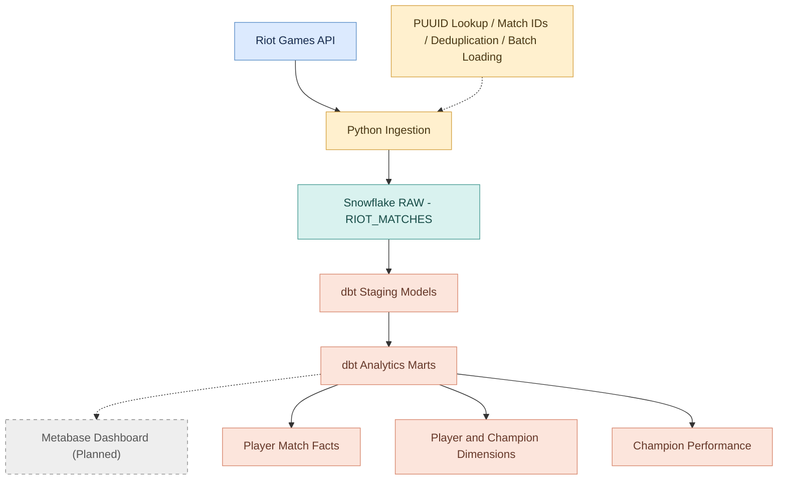

# Competitive Gaming Analytics | End-to-End Analytics Engineering Project

## Overview

This project demonstrates an end-to-end analytics engineering workflow using match data collected from the Riot Games API.

The goal is to transform raw League of Legends match data into reliable, analytics-ready datasets that allow players to understand their performance, identify strengths and weaknesses, and make data-driven decisions to improve their gameplay.

The project is designed to answer questions such as:

- **Champion Performance:** Which champions do I perform best with, based on win rate, KDA, and other performance metrics?
- **Player Performance:** How does my performance vary across different matches and champions?
- **Gameplay Analysis:** How do metrics such as damage dealt, vision score, and early-game deaths relate to match outcomes?
- **Team Performance (Planned):** How do team objectives, such as dragons, barons, and first towers, relate to winning games?

## Project Objectives

The primary focus of this project is to apply analytics engineering principles to a real-world data pipeline, including:

- **Data Ingestion:** Extract match data from the Riot Games API using Python and load it into Snowflake.
- **Data Modeling:** Transform nested JSON data into structured fact and dimension tables using dbt.
- **Data Quality:** Implement automated tests to validate data integrity, uniqueness, and metric correctness.
- **Metric Definitions:** Establish consistent definitions for metrics such as win rate, KDA, and champion performance.
- **Data Visualization (Planned):** Build dashboards that allow users to explore player and team performance.
- **Pipeline Reliability:** Handle duplicate records, API limitations, and unexpected data issues throughout the pipeline.

## League Analytics Warehouse — Architecture

### Riot Games API, Python Ingestion

Match data is collected from the Riot Games API using python ingestion script.

The ingestion process follows four steps:

1. Retrieve player PUUIDs using their RIOT IDs.
2. Collect the last 100 match IDs associated with each player.
3. Compare collected match IDs against existing Snowflake records to identify new matches.
4. Download new match payloads and load them into Snowflake.

**Design Decisions**

I used python to gather data using API requests, JSON responses, and ingestion logic.

Because multiple tracked players can participate in the same match, I decided to deduplicate match IDs before downloading match details. This allowed me to reduce API calls, download less data, and prevents redundant ingestion.

I chose to load the raw JSON data directly into Snowflake to preserve the original data and practice an ELT workflow. Instead of transforming the data in Python, I use dbt to handle transformations inside Snowflake.

### Snowflake RAW — RIOT_MATCHES

Match data collected through the Python ingestion pipeline is loaded into the `RIOT_MATCHES` table within the `RAW` schema in the `LEAGUE_ANALYTICS` Snowflake database.

The table contains three columns:

- `match_id`: Unique identifier for each match.
- `loaded_at`: Timestamp of when the match was loaded into Snowflake.
- `payload`: Original JSON data returned from the Riot Games API.

### dbt Staging Models

The staging model takes the raw match data from Snowflake and uses `LATERAL FLATTEN` to separate the 10 participants in each match into individual rows.

I also cleaned up field names, converted data types, and removed duplicate match-participant records to ensure each player only has one record per match.

### dbt Analytics Marts

After cleaning the data in staging, I used dbt to create fact and dimension tables for analyzing player and champion performance.

The player-match fact table contains match performance data such as kills, deaths, assists, and wins. The dimension tables contain information about players and champions.

I separated these tables to make the data easier to query, avoid repeating descriptive information, and allow different analyses to use the same data.

I also created a champion performance model to calculate metrics such as games played, wins, and win rate for each player and champion.

**Fact Table Grain**

The grain for `fct_player_matches` is one row per player per match. I chose this because each player has their own performance statistics within a match. This allows me to analyze individual player performance and aggregate results by champion across multiple matches.