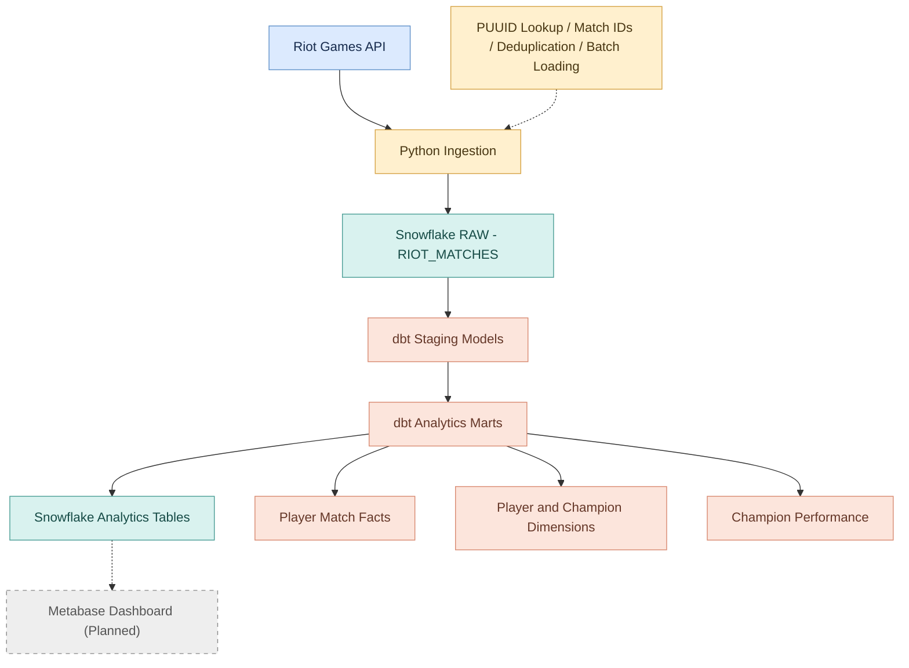

# Competitive Gaming Analytics | End-to-End Analytics Engineering Project

## Overview

This project demonstrates an end-to-end analytics engineering workflow using match data collected from the Riot Games API.

The goal is to transform raw League of Legends match data into reliable, analytics-ready datasets that allow players to understand their performance, identify strengths and weaknesses, and make data-driven decisions to improve their gameplay.

The project is designed to answer questions such as:

- **Champion Performance:** Which champions do I perform best with, based on win rate, KDA, and other performance metrics?
- **Player Performance:** How does my performance vary across different matches and champions?
- **Gameplay Analysis:** How do metrics such as damage dealt, vision score, and early-game deaths relate to match outcomes?
- **Team Performance:** How do team objectives, such as dragons, barons, and first towers, relate to winning games?

## Project Objectives

The primary focus of this project is to apply analytics engineering principles to a real-world data pipeline, including:

- **Data Ingestion:** Extract match data from the Riot Games API using Python and load it into Snowflake.
- **Data Modeling:** Transform nested JSON data into structured fact and dimension tables using dbt.
- **Data Quality:** Implement automated tests to validate data integrity, uniqueness, and metric correctness.
- **Metric Definitions:** Establish consistent definitions for metrics such as win rate, KDA, and champion performance.
- **Data Visualization:** Build dashboards that allow users to explore player and team performance.
- **Pipeline Reliability:** Handle duplicate records, API limitations, and unexpected data issues throughout the pipeline.

## League Analytics Warehouse — Architecture

